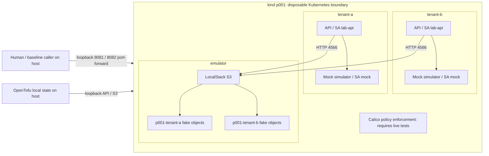

# Architecture

Host runs bootstrap, OpenTofu and test tools. kind holds all deployed workloads;
LocalStack is an AWS API emulator inside a separate namespace, not an AWS account.
API callers select a tenant-specific port and bearer fixture. A workload's tenant is
fixed by deployment configuration, never chosen by request body. One S3 bucket per
tenant holds only uniquely keyed `fixture-*` synthetic markers. No model inference
occurs; mock hashes the prompt deterministically and identifies itself as a simulator.

Bootstrap scripts own kind, vendor-pinned Calico, namespaces and emulator availability.
These precede OpenTofu because providers must reach Kubernetes and S3 during planning.
OpenTofu owns tenant deployments, services, RBAC, policies and buckets. No local-exec
chains. State and plan files stay ignored. Calico has privileged node networking
permissions in kube-system; LocalStack requires a writable image filesystem and is
not placed under tenant restricted Pod Security Admission. Neither exception grants
those privileges to API/mock pods. These are explicit platform trust dependencies.
