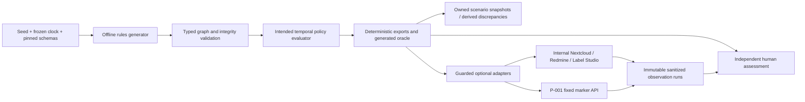

# Architecture

SYNTHETIC — TRAINING DATA — NOT A REAL CLIENT

Core generation is pure Python/Pydantic with a seeded local PRNG. It builds records
in dependency order using reserved domains and fixed templates. Cross-record checks
run after typed parsing. JSON Schema describes structural constraints; Python graph
validation additionally enforces references, ownership, chronology and policy parity.
The schema is not a replacement for graph validation.

The same namespace is used by serialized models, table exports, scenario assets,
external mappings and evidence. Core tests execute without services. SDV is imported
only when explicitly requested and changes bounded numerical invoice fields, followed
by exact request/approval rebinding and the same canonical validation.

No queue, web UI, training infrastructure, vector store, SSO or real identity provider
is deployed. No later assessment project is implemented. A stale retrieval fixture is
a file for a later consumer, not a functioning RAG connector. P-001 remains separate.
Adapters map only capabilities exercised through the actual API; unsupported deny,
classification, delegation and approval semantics remain explicit limitations.
