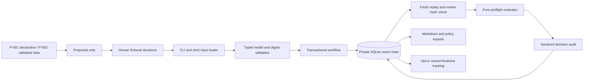

# Architecture and data flow

SYNTHETIC TRAINING ENGAGEMENT — NOT AUTHORIZATION FOR REAL-WORLD TESTING

There is no arrow from the evaluator to a target, scanner, LLM, DNS, mail service
or cloud API. The pure function accepts typed policy, current state, bound approval,
request and externally verified evidence status. Store.check replays the current
ledger, verifies review bytes and evaluates under BEGIN IMMEDIATE. The transaction
also appends the decision, ordering it against suspension and amendments. There is
no decision cache, approval bearer token or background service.

The single local OS account owns the store. SQLite serializes writers; SHA-256
links detect accidental edits/reordering. They cannot defend against that account
replacing a database, reconstructing all hashes or impersonating an actor label.
Exports are portable planning contracts, not signed capabilities or real-time
revocation feeds. Future runners must independently integrate and enforce checks.
