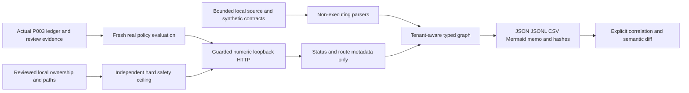

# Architecture

The trusted boundary is the existing local checkout and operator-owned filesystem.
No imported text is evaluated or used to choose tools. Offline import does not
construct an HTTP client, browser, socket, resolver, provider or remote schema
resolver. Declared external URLs remain inventory data only.

Modules have explicit purposes: `safety.py` handles containment/size/serialization;
`models.py` strict data contracts; `parsers.py` declarations; `graph.py` stable
IDs and claim conflicts; `correlation.py` explicit cross-run mapping; `policy.py`
P-003 adapter and tool ceiling; `transport.py` sole live egress path; `optional.py`
refusals/passive contracts; `reporting.py` exports and ownership cleanup.

Assets are keyed by environment, tenant and source-stable logical key. Endpoints
also include normalized origin, method and exact path template. Identities are
never merged on a display name. Every flow is directional, has evidence and a
permission assumption. Candidate crossings remain INFERRED, even when an HTTP
response is observed. A shared policy declaration does not prove enforcement.

On failure, an input's partial mutations roll back; remaining independent inputs
continue. The final run is PARTIAL with actual coverage/error rows. Failed live
runs retain attempted-request counters and decisions without raw bodies. Graph
and memo exports can be reconstructed independently from a validated snapshot.
