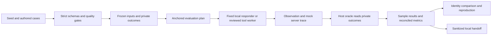

# Architecture and data flow

`models.py` defines 21 contracts; `generation.py` owns deterministic authored
cases, explicit labels and lineage splits. `quality.py` validates references,
content identity, labels, duplicates and lineage. `registry.py` stores write-once
versions and separate anchors. `pipeline.py` binds current source and configuration
hashes to a bounded plan, retains observations, and invokes host-side `scoring.py`.
`comparison.py` compares all relevant identities before reporting transitions.
`laboratory.py` preserves twelve original/altered pairs. `exports.py` projects
sanitized records. `integrations.py` consumes actual sibling contracts read-only.

The flat module layout deliberately groups cohesive components instead of adding
many one-function packages from the suggested directory sketch. Every requested
core capability has executable behavior; task/scorer/evaluator identities are
typed data, never user-supplied Python imports. The CLI is the public operator API.

P-008 owns no target execution engine, central telemetry store or consultancy risk
register. The mock environment is an evaluation fixture, not a rebuilt P-006.
Host processes and local storage are trusted; hashes do not resist an attacker
who rewrites every artifact and its independently retained anchor.
