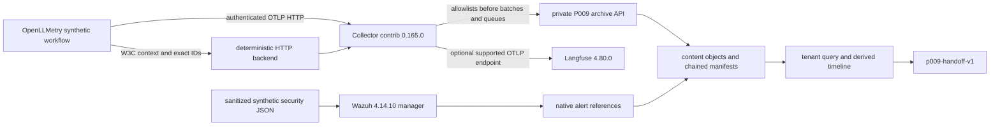

# Implemented architecture

The typed Python package owns normalization, bounded pre-persistence ingestion, tenant-scoped
queries, exact-ID correlation, a content-addressed local archive, audit records, retention and
handoffs. The synthetic workflow executes OpenLLMetry decorators around authorization, a real
arithmetic tool and an HTTP call to a deterministic backend. No actual model is evaluated.

Langfuse requires PostgreSQL, Redis, ClickHouse and S3-compatible MinIO. The optional AI gateway
in its upstream compose file is outside P009's scope. Wazuh manager-only detection is distinct
from its indexer/dashboard stack, which requires a compatible host. Actual verification statuses,
not diagram edges, determine which integrations have been demonstrated.
