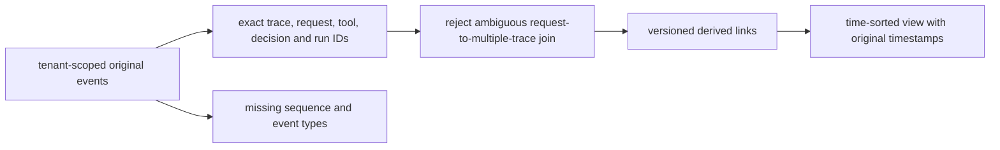

# Exact identifier correlation

`p009-exact-v1` links only exact shared identifiers within an already authorized tenant scope.
Time, similar content, usernames and actor/session resemblance create no link. Multiple traces
claiming one request produce ambiguity. Explicit source-event references link alerts only when
the referenced event is unique. Link identity uses a digest of source ID plus event ID.

Arrival order, original timestamps, clock skew, partial authorization records and missing controlled
sequence members remain visible. A timeline is a derived layer; original records are not rewritten.
A sequence gap is limited to the observed bounded range. Absence does not prove nonoccurrence.
