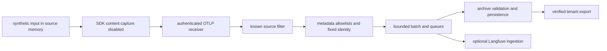

# Collection and export data flow

Source content suppression precedes the first SDK exporter. Collector receivers authenticate
the local producer; a source allowlist precedes fixed resource identity, allowlist transforms,
bounded batch processing and exporter queues. The archive validates normalized metadata before
queueing and persistence. OTLP traces, metrics, audit logs and security logs have separate pipelines.

Original source time, observed time and source-version references remain distinct. Local
digests cover normalized bytes, not an original prompt or hidden source content. A source
digest is a consistency reference, not authentication. Time proximity creates no timeline link.
