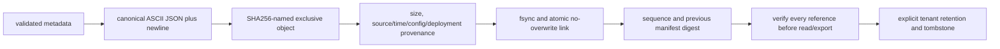

# Evidence archive

Archive roots require an exclusive P009 owner marker, Unix ownership and private permissions.
Directories are traversed with directory descriptors and O_NOFOLLOW. Regular files only, bounded
reads, one hard link and safe relative import paths prevent redirection. A lock serializes native
application writes. Existing evidence is never replaced by application creation operations.

Objects, chained manifests, access audits, deletion tombstones and exports are separate layers.
Replay detection uses source/tenant/event identity and normalized-source digest. A changed payload
with the same identity is a conflict. Original source statuses and references are not rewritten.
Native archive volume, local offline archives and optional product databases have separate lifecycles.
