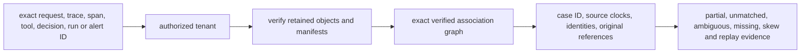

# Incident timeline investigation

`./scripts/p009 timeline --key trace_id --value <synthetic-id>` works against the selected local
archive. `--archive` selects an explicit owned archive; native API `/timeline` uses bearer-bound
tenant identity. The offline demo writes a unique retained timeline with an intentionally absent
sequence, duplicate delivery and out-of-order event. Source times remain unchanged.

The view distinguishes evidence integrity, association and interpretation. It does not turn an
alert, failed test, evaluation metric or time ordering into causality, compromise or a finding.
P006 missing request correlation and P008 metadata-only coverage remain visible limitations.
