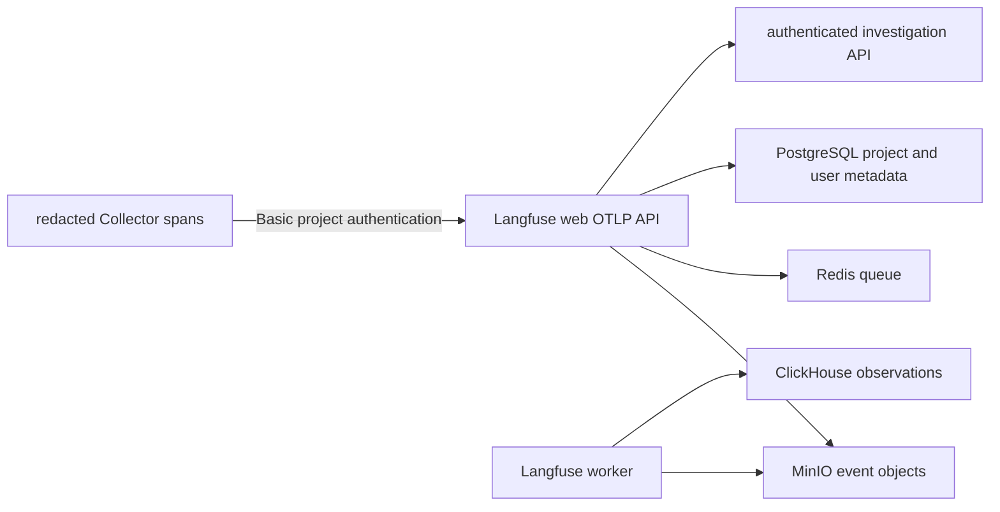

# Langfuse integration

Inventory #117 pins **Langfuse 4.80.0** web and worker images. Official v4.80.0 source verifies
`POST /api/public/otel/v1/traces` and authenticated v2 observation retrieval. Collector configuration
uses the supported `/api/public/otel` exporter base, adding the OTLP signal suffix. Generated
project keys stay in runtime environment variables, never browser code or Git.

`langfuse/compose.yaml` derives dependencies/environment names from the pinned upstream compose.
Telemetry/sign-up are disabled, project/user credentials are generated, and networks are internal.
The default v4 `events_only` mode returns 404 for legacy trace reads. The verified path uses
`/api/public/v2/observations`, exact trace IDs and a bounded UTC time range. The earlier legacy-read
and 1GiB memory failures remain in local history. ClickHouse uses a 2GiB server budget, two query
threads, one insert thread, a bounded global pool and the host-compatible 16384 file limit.

The Docker Hub Chainguard MinIO distribution is pinned by digest; unavailable legacy MinIO tags
were not silently accepted. The exact successfully executed gates and any deployment blockers are
in validation-status.md. Project isolation, graphical UI access and retention each require their own checks;
trace ingestion does not establish them automatically. P009's archive is independent of Langfuse.
