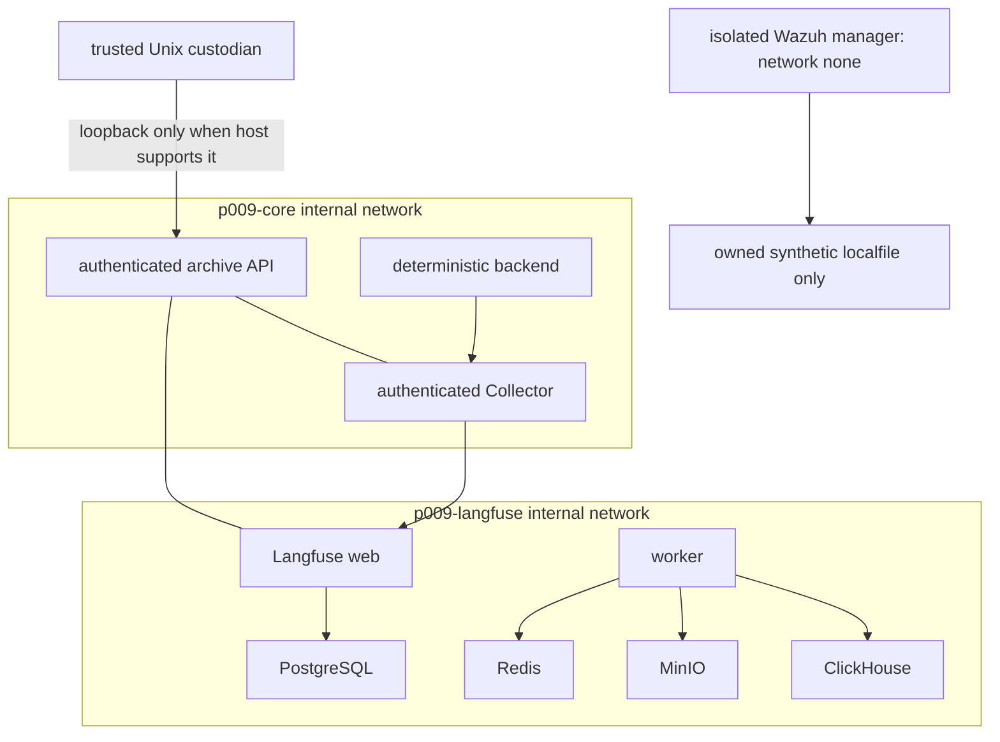
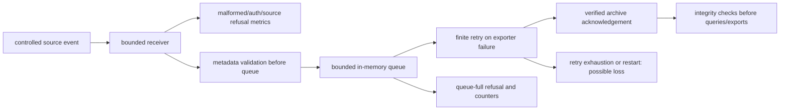

# Network trust and loss boundaries

No public/default Docker network is attached. Host publication remains loopback. Internal HTTP
and the local custodian/Docker daemon are trusted; production TLS/mTLS and independent host
assurance are not demonstrated. An archive process on the Langfuse network is an explicitly trusted
operator/probe boundary, not an untrusted frontend. Native datastores use generated credentials.

Counters reset with their processes unless separately retained. Neither health endpoints nor an
accepted receiver request prove downstream completeness. Long outages and Collector restarts can
lose in-memory batches. Gaps, duplicates and source sequencing support bounded investigation; they
cannot prove that an event never occurred. Actual measured failures remain in ignored history.
