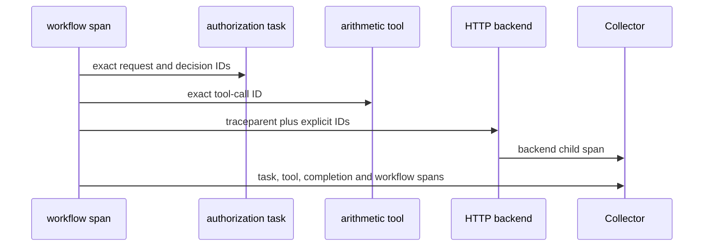

# OpenLLMetry instrumentation

Inventory #115 uses **traceloop-sdk 0.63.0**. The installed `Traceloop.init` API accepts an
explicit OTLP exporter, `trace_content=False`, `telemetry_enabled=False` and a W3C propagator.
Both `TRACELOOP_TRACE_CONTENT=false` and the explicit API option are set. Hosted Traceloop
sync and usage reporting are not enabled. No API key or real model is required.

The prompt canary is an executed task argument. `GuardedExporter` examines SDK output before
network export and refuses captured content or unsafe attribute/event/status strings. The backend
returns deterministic JSON; failure produces a fixed error status without raw provider text.
Library initialization alone is not a passing integration gate; real downstream spans are required.
