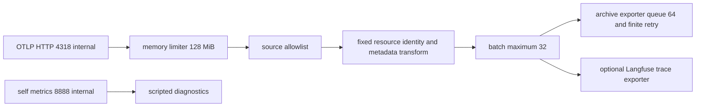

# OpenTelemetry Collector

Inventory #114 uses the official **contrib distribution 0.165.0**, whose upstream component
manifest includes basicauth, filter, transform, resource, batch, memory_limiter, health_check
and OTLP HTTP. The core repository remains the selected technology; contrib supplies the
verified processors/extensions. Exact image digest is in `config/images.lock.json`.

`collector/config.yaml` uses four signal pipelines and no sampling. Receiver bodies are bounded
to 65536 bytes. Export queues have one consumer, capacity 64, a 5-second request timeout and
10-second retry budget. Memory limits are application settings; Docker cgroup enforcement must
not be inferred on this rootless host. Queue capacity is batches, not a promise of total events.

Finite retries and in-memory queues can lose telemetry during prolonged failure or restart.
Accepted/refused/export-failed/queue metrics and archive counters must be interpreted together.
Health_check is process health, not proof that all exporters are delivering. Source filtering
can drop unauthorised resource identities; filter metrics are part of loss accounting.
