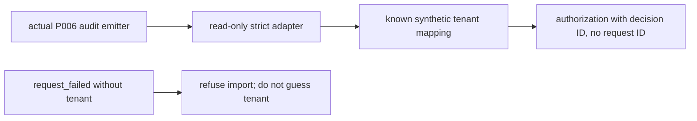

# Actual P006 source integration

P006 is merged in approved base `85302ea391f11df403630416b5dbf0decda831d3`. Its actual
`Engine.authorize` emits authorization, decision ID, policy version, reason, subject, tenant,
action and model. It does not log the request middleware's X-Request-ID. `request_failed`
has a request ID but lacks tenant context. No OTLP span source is assumed.

The engineering test executes the actual authorization method extracted from the unchanged PEP
with fixture identity/policy/limit dependencies and validates its emitted JSON. This is actual
source-method execution, not a running five-product P006 deployment. Live P006 log collection is
NOT_TESTED. Adapter status is PARTIAL; authorization/request association remains a documented gap.
P006's rootless/browser and P007 adapter limitations remain its own documented results. A future
P006 change could explicitly emit the middleware request ID, but P009 does not make that change.
