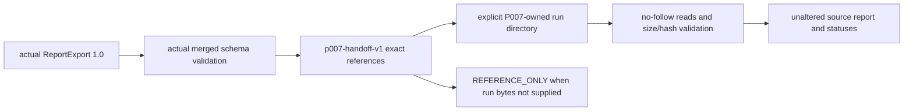

# P007 read-only import

The importer reads the actual sibling JSON Schemas without importing a P007 runner. It validates
run identity, handoff shape, safe relative paths, unique references, manifest digest, artifact
sizes/digests and report/manifest agreement. Symlinked components, special files, oversized files
and traversal fail. Fixtures exercise byte verification without executing a P007 test catalog.

PASS/FAIL/BLOCKED/NOT_TESTED/INCONCLUSIVE/NOT_APPLICABLE/FLAKY, expectations, observations, assertions,
runner metadata, definition/compatibility hashes, control status and provenance stay unchanged.
The committed actual example has no accompanying run bytes here and imports as REFERENCE_ONLY.
Nothing is promoted into a client finding, reproduction result or fresh scope authorization.
