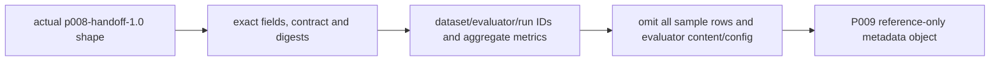

# P008 metadata import

The importer checks `p009.kind=evaluation-event-references`, run/manifest identities and the
actual evaluator/metrics subcontracts. It preserves dataset/version, evaluator/version, plan
and manifest digests, aggregate metrics, limitations and provenance. Sample results, critical/
flaky sample IDs and evaluator prompt/config fields are omitted. No sealed store is opened,
sample outcome reconstructed, benchmark run executed or metric converted into a finding.

No generated P008 handoff file existed in this checkout at discovery. `fixtures/p008-handoff.json`
is explicitly an authored contract fixture, not evidence of a native P008 run. A manifest digest
alone supplies no raw telemetry. Live telemetry integration remains metadata-only/REFERENCE_ONLY.
