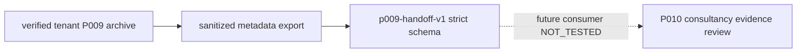

# Future P010 contract

`schemas/p009-handoff-v1.schema.json` records tenant, object and manifest digests, source provenance,
source status counts, correlation/redaction versions, telemetry coverage and explicit limitations.
`findings` must be empty and consumer status remains NOT_TESTED. Export is local, exclusive and
audited. Source P007 statuses remain distinct and P008 sample outcomes are not reconstructed.

The contract accompanies human-readable timeline text and machine-readable event/import metadata.
It is a future interface, not a P010 implementation or a severity/risk decision. Consumers must
validate scope, source references, byte consistency, gaps and interpretation before any assessment.
