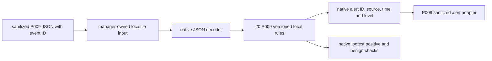

# Wazuh integration

Inventory #119 pins **Wazuh 4.14.10** manager, indexer and dashboard artifacts. The managed host
reports `vm.max_map_count=65530`; the indexer's documented prerequisite is 262144. P009 changes
no host kernel/firewall settings and does not disable indexer security to start it.

The staged manager-only profile has no network, host mounts, privileged agent, Docker socket or
host log input. Wazuh's own runtime files reside only in its owned container. `wazuh/ossec.conf`
collects `/p009/events.jsonl`; P009 appends only its synthetic metadata. `wazuh-logtest` exercises
the actual native rule engine independently of daemon collection. Each input's phase output is
checked separately, so a benign false positive cannot replace a missing abnormal result in an
aggregate count. Those are separate assertions from daemon ingestion.

The manager uses the official image initialization hook to restore its staged files, ownership
and native certificates. Its native upstream decoder/rule/CDB set remains present alongside
P009's parent and 20 child rules. Rootless namespace capabilities are limited to SETUID, SETGID,
CHOWN, FOWNER, DAC_OVERRIDE, SYS_CHROOT and KILL, with no-new-privileges; these support native
daemon initialization/chroot and lifecycle. No privileged container or host capability change is used.

Manager-only rule execution is not the complete indexer/dashboard profile. The full gate remains
BLOCKED/NOT_TESTED until the separate verified host profile exists. Native alerts are observations,
not confirmed findings, endpoint detection, host forensics or SOC coverage.
