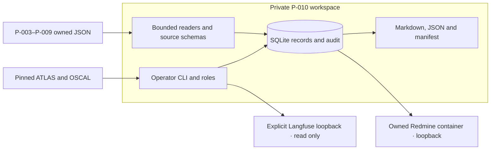
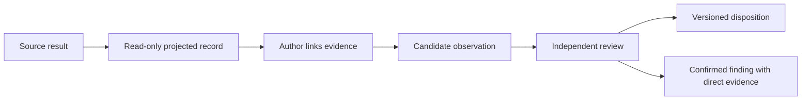
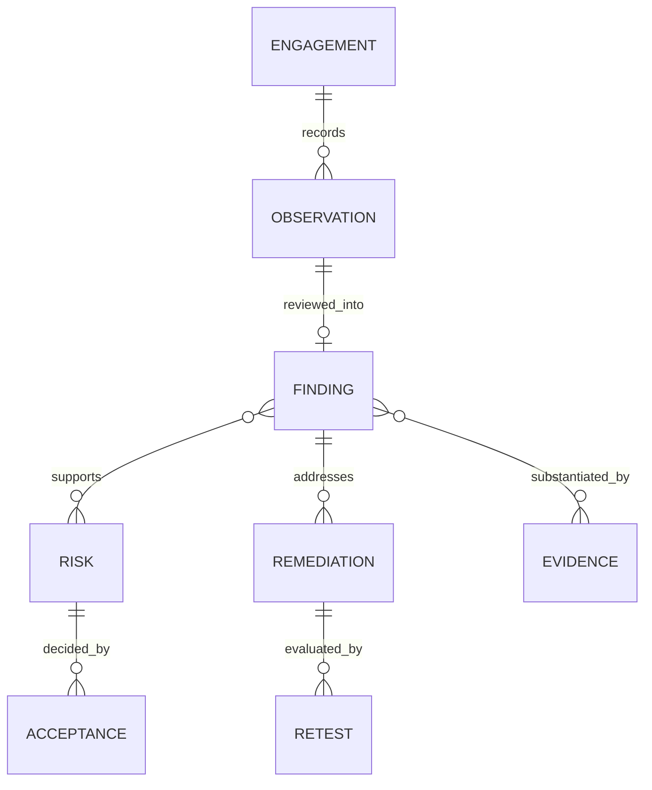

# P-010 architecture

The local Unix account and private workspace are the trust boundary. Source
files cross a bounded, read-only validation boundary. The CLI governs local
synthetic role permissions and commits canonical changes and audit events in a
single SQLite transaction. The report exporter reads frozen links to exact
record versions. Redmine and Langfuse are optional and separately configured.

## Components and trust boundaries

## Assessment source to finding

## Relationships

The remaining flows are documented with the [state machine](finding-lifecycle.md),
[rubric](severity-and-risk-rubric.md), [evidence](evidence-quality.md), source adapters
[P-003](p003-integration.md), [P-005](p005-integration.md), [P-007](p007-integration.md),
[P-008](p008-integration.md), [P-009](p009-integration.md), [Redmine](redmine-integration.md),
[OSCAL](oscal-integration.md), [ATLAS](atlas-integration.md), [Langfuse](langfuse-integration.md),
[report approval](human-review-and-approval.md), [retention](retention-and-deletion.md)
and the [handoff](p010-handoff.md).
