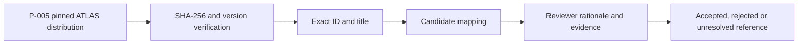

# MITRE ATLAS #125

The offline adapter reads the existing licensed P-005 ATLAS 2026.10
distribution, format 6.1.0, commit `f56c1468731d6428e5bf875263b4643b46d67437`.
The mapping test exercised `AML.T0051` and retained the exact catalog title,
review state and related evidence. A synthetic diagnostic classification
example provides no technique evidence, so its demo report omits a mapping.
A later catalog change can flag a removed or renamed technique without
rewriting the historical report.
