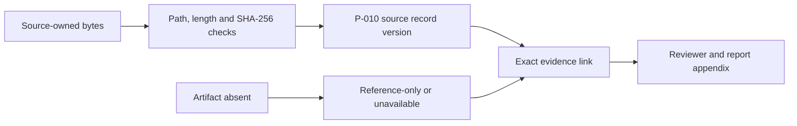

# Evidence quality and provenance

Evidence quality ranges from UNKNOWN or INSUFFICIENT to LIMITED and
CORROBORATED. Record confidence separately. Hashes establish byte consistency.
Source authenticity, trusted time, signer identity and independent custody are
unverified. Reports contain metadata by default. An explicit excerpt
selection is recorded and redacted. Compare original P-007 bytes using an
explicitly selected source run root.
