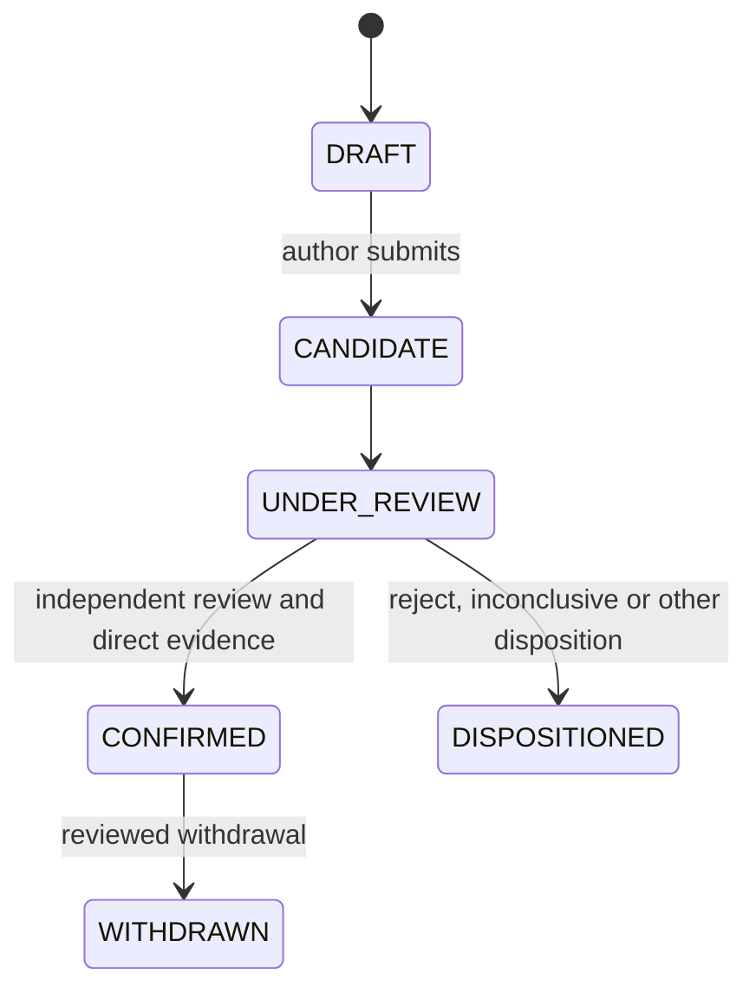

# Finding lifecycle

A submitted observation retains the asset, scope, observed/expected behavior,
preconditions, alternative explanations and limitations. Confirmation requires
an independent reviewer, enough evidence quality, exact in-scope assets,
and inspected byte-verified direct evidence. A source hypothesis, evaluation,
telemetry alert or trace can provide context. A source failure remains its
original status, even when the reviewer links it to a finding.

Finding lifecycle, severity, remediation and retest state each have their own
fields. The system owner reports an implementation. A reviewer compares
exact original/new references and the source configuration before recording
a retest. Closure requires reviewed evidence for the resolved behavior,
comparable configuration, regression results and current scoped owner decisions.
