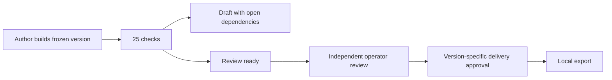

# Human review and approval

Record author, reviewer and decision provenance explicitly. Review and
approval each require the current report digest and a rationale. Role
labels are assertions from the local synthetic roster. The fixture
exercise remains REVIEW_READY even after a simulated checklist review.
Earlier approvals remain retrievable when a new report version is built.
Local export writes a private package for review.
