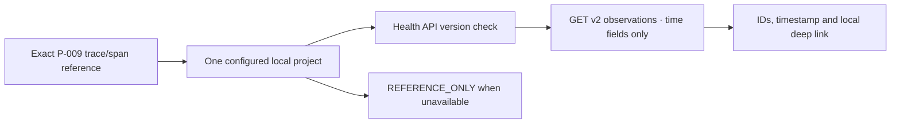

# Langfuse #117

The connector targets Langfuse 4.80.0, the version pinned by P-009.
Official endpoint and field definitions were inspected. Tests check exact
trace/project/time, pagination bounds and metadata projection using a
deterministic API double. The P-009 exercise generated reference IDs, but
the P-010 adapter was not run against a native Langfuse deployment on this
host. It recorded REFERENCE_ONLY and NOT_TESTED. The opt-in read accepts a
numeric loopback port and explicit project binding. Provide credentials
through a private environment. Keep credentials out of browser code, reports and Git.
