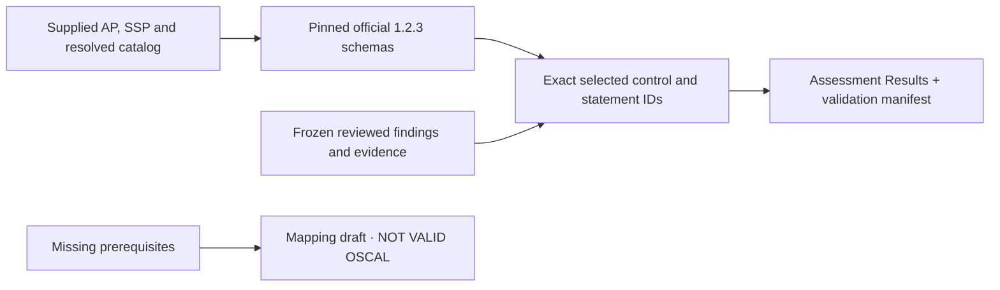

# NIST OSCAL #128

P-010 uses exact release bytes and records schema ID, digest, OSCAL and
validator versions. Regex validation supports Unicode patterns in the official
schemas. Assessment Results bind reviewed finding IDs, collection time,
source references, evidence digests, related risks and matched control
statements. Support is limited to explicit statement selection and local
AP→SSP→resolved catalog links. The exact official Assessment Results fixture
passed structural and implemented reference checks. The default engagement
has no supplied AP/SSP/catalog and emits a nonconformant mapping draft.
POA&M schema validation is available. POA&M generation, profile resolution
and objective mapping remain unsupported.
