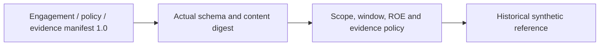

# P-003 engagement and scope

The approved synthetic policy example and engagement specification validated
read-only. The adapter retains historical expiry, revocation, window, scope,
authority caveats and ledger digest. A named P-003 policy must match the P-010
scope, window and included assets. Confirmation checks the observation asset
and direct evidence time. Target testing requires independently maintained
authorization outside this product. P-003's OSCAL mapping draft retains
`NOT VALID OSCAL`.
