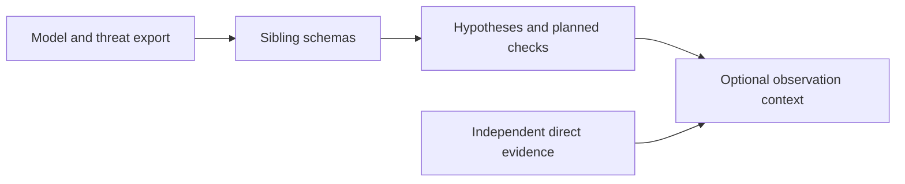

# P-005 hypotheses

The actual P-005 model, eight selected threats, verification cases and
risk catalog were consumed. P-005 editorial review and versioned mapping or
traceability exports have read-only adapters. P-005's 14 unsourced entries
remain unresolved. Its verification cases remain NOT_TESTED and its
hypotheses remain HYPOTHESIS. Separate evidence and P-010 review are
required for any new finding.
