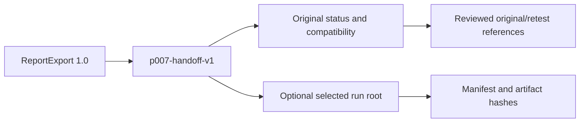

# P-007 ReportExport 1.0

The example preserved its FAIL, FLAKY and PASS statuses. Its original
artifact bytes were unavailable, so the evidence remains REFERENCE_ONLY.
An explicitly selected run root is checked for ownership metadata,
version, exact manifest bytes, report consistency, safe artifact paths,
sizes and hashes. Synthetic fixture tests verify tamper and missing-byte
behavior. The adapter retains allowed observed metrics and runner metadata
and omits raw output, executable command descriptions and samples.
