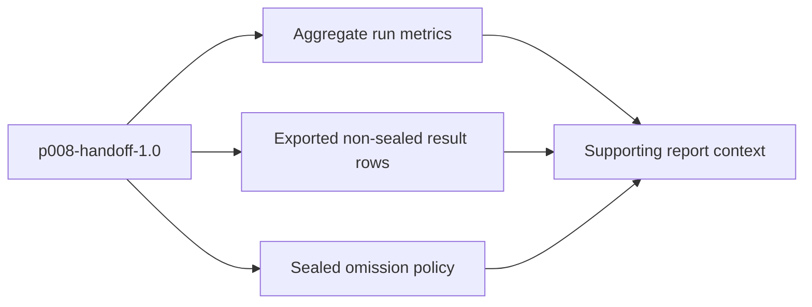

# P-008 sanitized evaluation

The actual offline P-008 exporter produced a 48-observation handoff
with 38 public rows and 10 omitted sealed rows. Aggregate metrics may
include sealed observations. P-010 validates evaluator and metrics shape,
result row types and count arithmetic. Evaluator prompts and judge prompts
are dropped. P-008's P-010 findings array stays empty. The checked-in
test fixture replaces the evaluator prompt text and is distinct from the
actual local handoff retained for the demonstration.
