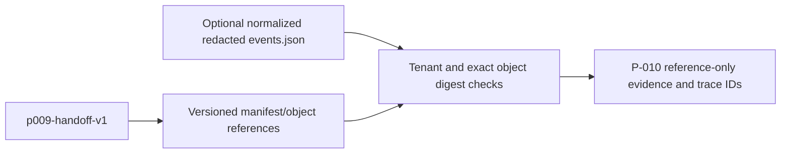

# P-009 telemetry and evidence

The approved base contains P-009 and its actual v1 handoff schema. A local
offline P-009 producer created a five-event synthetic handoff. The P-010
consumer verified compatible metadata, tenant and redacted event object
digests. P-009 remains authoritative for archive and product observations.
Each trace or alert remains supporting context. Real event collection,
archive authenticity and native product status are outside P-010 intake.
