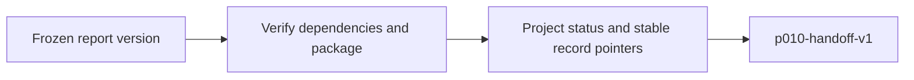

# p010-handoff-v1

The handoff includes an exact report link, status, finding validation and
review state, reviewed severity where available, and source/risk/evidence
references. Downstream use must preserve synthetic scope, source ownership,
report status and review provenance. The handoff carries no runtime
credentials or raw evidence. Local reports and records use separate schemas.
