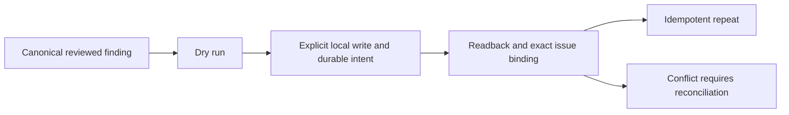

# Redmine #142

Redmine 7.0.3 runs in a network-disabled Docker container. Rails listens
only inside the container and the adapter accesses it through an owned
Docker exec transport. No ports are published. Bootstrap creates a private
project and separate synthetic write and read-only roles. Credentials remain
in the fixture and are removed with it. The sync mapping stores subject,
assessment reference, priority, due date, owner reference in the description
and a stable synchronization key. Closure and risk acceptance stay in P-010.

A fresh native check verified create, readback, repeated sync, a local update,
read-only user rejection, conflicting edit preservation and owned cleanup.
Tests also check outage, malformed results and uncertain-write reconciliation.
If the local journal has an unresolved write or Redmine changed independently,
inspect the exact issue and workspace binding before any retry. An external
project or arbitrary URL has no supported transport.
