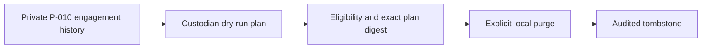

# Retention and deletion

The retention plan displays record-type periods and waits until all
linked records and the engagement window qualify. A transactional purge
removes canonical records for that engagement, leaving audit tombstones
and integrity references. Verify the current plan digest and explicit
ownership confirmation before applying it. Exported packages, private
copies and upstream records follow their own retention. Redmine cleanup
owns only its local container and named volume. It performs no Redmine
issue deletion API.
