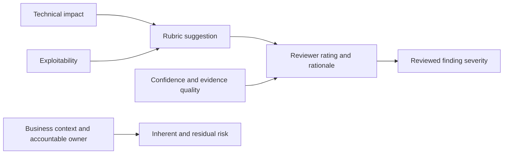

# Severity and risk rubric p010-risk-rubric-1.0

The local rubric uses ordinal impact and exploitability dimensions. It requests
likelihood, exposure, business context, compensating controls and uncertainty.
The suggestion table and content digest are available from `p010 rubric`.
Only an attributed reviewer decision sets the canonical severity. A reviewer
override preserves the suggestion and rationale. An unknown dimension or
insufficient evidence yields UNRATED.

LOW denotes a bounded issue. MEDIUM denotes material consequences with
constraints. HIGH denotes severe consequences or a repeatable material path.
CRITICAL denotes widespread consequences with a likely or repeatable path.
The optional CVSS record retains the supplied version, vector, source and
limitation. The rubric establishes a local training judgment.
